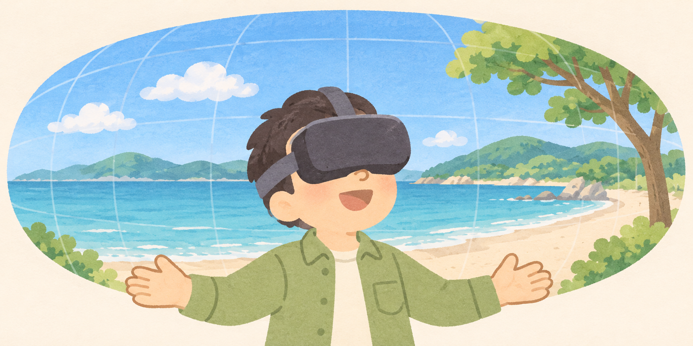
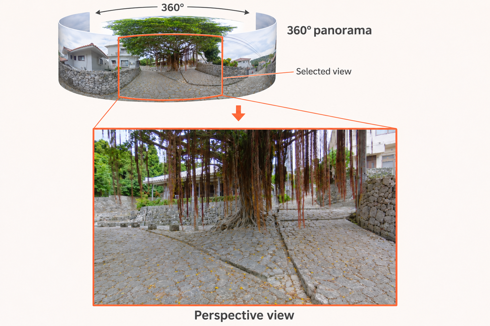

# SphericalViewer

<div align="right">
Author: Hiroshi Ban<br>
Last Update: "2026-11-09 22:33:46 ban"
</div>

<br>
<div align="center">


<br>

</div>
<br>

**A MATLAB viewer for 360° VR images and videos.**



SphericalViewer was developed to inspect panoramic images and videos
while preparing experiments in visual psychology and neuroscience.
It provides lightweight MATLAB graphics viewers and optional fullscreen
Psychtoolbox-3/OpenGL viewers.

***

## Menu

- [Introduction – what is SphericalViewer?](#introduction)
- [System requirements](#system)
- [How to run SphericalViewer](#launch)
- [Controls and media layouts](#controls)
- [Sample images and videos](#samples)
- [Contents of the repository](#contents)
- [Acknowledgments](#acknowledgments)
- [License](#license)
- [Citation and contact](#citation)
- [Limitations](#status)

***

<a id="introduction"></a>
## Introduction – what is SphericalViewer?

360-degree VR images are commonly stored as **equirectangular panoramas**:
longitude runs horizontally and latitude vertically. SphericalViewer maps
these panoramas onto the inside of a sphere and places the camera at its
center. You can look around and change the field of view with the mouse.

The package helps check scene content, orientation, stitching artifacts,
and one eye of stereo material before using it in an experiment. **Packed
stereo inputs are previewed through a single eye**: the top image for
over-under, or the left image for side-by-side. HMD output, head tracking,
and binocular stereo presentation are outside the current implementation.



*A selected direction and field of view within the 360-degree panorama are
shown as a perspective view. Illustration: CC BY-NC 4.0, Hiroshi Ban.*

The project is shared to support open and transparent research and to help
others learn how to work with VR material in MATLAB. Thank you for using
this software. I hope SphericalViewer can help your research projects.

[back to the menu](#menu)

<a id="system"></a>
## System requirements

- **MATLAB** with desktop graphics. Tested with **MATLAB R2023b
  Update 11 on Windows**; see the [validation record](doc/VALIDATION.md).
  Earlier releases, macOS, Linux, and GNU Octave have not been validated.
- The standard viewers require **no additional MathWorks toolboxes**.
- Video support depends on the codecs available to MATLAB's `VideoReader`.
  The supplied MP4 contains H.264 video and AAC audio.
- **Optional PTB viewers:** a working [Psychtoolbox-3](https://psychtoolbox.org/)
  installation with OpenGL/MOGL and the movie-decoding dependencies required
  for your platform, including GStreamer where required. Follow PTB's own
  installation instructions.
- Sufficient graphics texture memory for the input resolution. The samples
  contain a 5760 x 2880 image and 3840 x 3840 video frames.

MATLAB and Psychtoolbox are separate products with their own licensing
terms. Neither is bundled in this repository.

[back to the menu](#menu)

<a id="launch"></a>
## How to run SphericalViewer

Download or clone the repository and make its root the MATLAB current
folder. Alternatively, add the root folder to the MATLAB path:

```matlab
addpath('path/to/SphericalViewer');
```

MATLAB finds the internal functions in `private/` automatically. Keep the
repository structure intact; adding its subdirectories to the path is unnecessary.

### Common entry point

```matlab
SphericalViewer(videoType, filepath, renderer)
```

| Argument | Meaning | Default |
| --- | --- | --- |
| `videoType` | `1`: mono; `2`: over-under; `3`: side-by-side | `1` |
| `filepath` | Image/video path; `[]` opens a file dialog | File dialog |
| `renderer` | `'matlab'` or `'ptb'` | `'matlab'` |

The layout is selected explicitly. The argument `videoType`
applies to both images and videos. The common entry point routes `.mp4`,
`.mov`, `.avi`, and `.m4v` files to a video viewer; other extensions go to
the image viewer. Cancelling the file dialog returns without opening a display.

Run these examples from the repository root, closing each viewer before
opening the next:

```matlab
% Select your own mono image or video.
SphericalViewer;

% The sample image already contains one complete eye/panorama.
SphericalViewer(1, fullfile('samples', 'sample_360deg_VR_image.jpg'));

% Show the top eye of the sample over-under stereo movie.
SphericalViewer(2, fullfile('samples', 'sample_360deg_VR_movie.mp4'));

% Optional Psychtoolbox/OpenGL rendering, with movie audio.
SphericalViewer(2, fullfile('samples', 'sample_360deg_VR_movie.mp4'), 'ptb');

% Select side-by-side material with a file dialog.
SphericalViewer(3, [], 'matlab');
```

### Individual viewers

The four individual functions take the same first two arguments. Their
header comments are available through MATLAB's `help` command.

| Function | Implementation | Display and audio |
| --- | --- | --- |
| `SphericalImageViewer(videoType, imagefile)` | MATLAB axes and `imread` | MATLAB figure |
| `SphericalVideoViewer(videoType, moviefile)` | MATLAB axes and `VideoReader` | MATLAB figure; silent |
| `SphericalImageViewerPTB(videoType, imagefile)` | PTB/OpenGL image texture | Fullscreen |
| `SphericalVideoViewerPTB(videoType, moviefile)` | PTB movie decoder and OpenGL textures | Fullscreen; audio enabled |

The standard video viewer returns at the end, leaving the last frame open
for inspection. PTB uses the highest-numbered PTB screen and closes its
window when video playback finishes.

[back to the menu](#menu)

<a id="controls"></a>
## Controls and media layouts

| Action | Standard MATLAB | Psychtoolbox |
| --- | --- | --- |
| Look around | Drag within the figure | Hold the left mouse button and drag |
| Zoom | Mouse wheel | Mouse wheel where supported; `+`/`=` or Up arrow to zoom in, `-` or Down arrow to zoom out |
| Exit | Escape while the figure has focus, or close the window | Escape |

The initial field of view is 60 degrees, with a range of 5–140 degrees.
Pitch is limited to ±89 degrees. On Windows, PTB attempts raw mouse-wheel
events through `KbQueue`; support depends on the PTB version and device.
Keyboard zoom remains available when wheel input is unavailable.

| `videoType` | Input arrangement | Portion displayed | Typical overall aspect ratio |
| --- | --- | --- | --- |
| `1` | Mono equirectangular panorama | Whole image/frame | 2:1 |
| `2` | Over-under (OU or top-bottom) | Top half | 1:1 |
| `3` | Side-by-side (SBS) | Left half | 4:1 |

Packed stereo inputs must split into two equal pixel dimensions. Layout and
eye order are not auto-detected; there is currently no bottom/right-eye
switch. Fisheye images, cubemaps, and VR180 material need conversion before use.

[back to the menu](#menu)

<a id="samples"></a>
## Sample images and videos

| File | Content | Layout and size |
| --- | --- | --- |
| [sample_360deg_VR_image.jpg](samples/sample_360deg_VR_image.jpg) | Banyan tree in Okinawa, Japan (2025) | Mono, 5760 x 2880 px, 4.90 MB; use `videoType = 1` |
| [sample_360deg_VR_movie.mp4](samples/sample_360deg_VR_movie.mp4) | Walking on a beach in Iki, Japan (2025) | Over-under stereo, 3840 x 3840 px, 50 fps, 9.00 s, 93.82 MB; use `videoType = 2` |

**These samples were commissioned by Hiroshi Ban. Copyright and
portrait/personality-rights permissions for public distribution have already
been cleared, as confirmed by Hiroshi Ban.** The samples are shared under
**CC BY-NC 4.0**, allowing noncommercial reuse and adaptation with attribution
and an indication of changes.

The movie is a nine-second excerpt copied without re-encoding from the
original recording. See the [sample notes](samples/README.md) for provenance
and media specifications, and the [sample license](samples/LICENSE.md)
for attribution and reuse terms.

[back to the menu](#menu)

<a id="contents"></a>
## Contents of the repository

```text
SphericalViewer/
  README.md                    English guide
  LICENSE.txt                  BSD 2-Clause code/documentation license
  CITATION.cff                 Software citation metadata
  Contents.m                   MATLAB help index
  SphericalViewer.m            Common entry point
  SphericalImageViewer.m       MATLAB image viewer
  SphericalVideoViewer.m       MATLAB video viewer
  SphericalImageViewerPTB.m    PTB image viewer
  SphericalVideoViewerPTB.m    PTB movie viewer
  private/                     Shared validation, cropping, and PTB rendering
  samples/                     Image, short movie, provenance, and media license
  doc/                         Validation notes and README illustrations
    images/                    README illustrations
```

[back to the menu](#menu)

<a id="acknowledgments"></a>
## Acknowledgments

The optional renderer uses [Psychtoolbox-3](https://psychtoolbox.org/) and
its OpenGL interface. Acknowledge Psychtoolbox in research using that path,
following the guidance for your installed version. MATLAB is a registered
trademark of The MathWorks, Inc.

Hiroshi Ban developed the initial version of SphericalViewer. He also
commissioned and provided the sample photography and video.

[back to the menu](#menu)

<a id="license"></a>
## License

- **Source code and project documentation:** [BSD 2-Clause](LICENSE.txt),
  copyright © 2026 Hiroshi Ban.
- **Sample images, movie, and illustrations in `doc/images/`:**
  [CC BY-NC 4.0](samples/LICENSE.md), excluded from the BSD license.
  Commercial reuse requires separate permission from Hiroshi Ban.
- Dependencies retain their own licenses.

[back to the menu](#menu)

<a id="citation"></a>
## Citation and contact

If SphericalViewer contributes to your research, please cite it as follows:

> Ban, H. (2026). *SphericalViewer: A MATLAB viewer for 360-degree VR images
> and videos* [Computer software]. GitHub.
> [https://github.com/hiroshiban/SphericalViewer](https://github.com/hiroshiban/SphericalViewer)

Contact Hiroshi Ban through his [GitHub profile](https://github.com/hiroshiban)
or the repository's [issue tracker](https://github.com/hiroshiban/SphericalViewer/issues).
Bug reports should include the MATLAB/PTB versions, operating system,
renderer, media layout, and error message.

[back to the menu](#menu)

<a id="status"></a>
## Limitations

- Standard MATLAB playback aims for the source frame rate, but decoding and
  drawing can slow it down. It provides no frame-accurate timing guarantee.
- PTB uses its movie clock and display flips. The viewers leave the caller's
  synchronization-test preference unchanged. Experimental timing, trigger
  handling, and response collection require separate implementation and validation.
- Fullscreen PTB rendering, texture orientation, device-specific wheel
  behavior, and audio need checking on the intended setup.
- Playback is once through. Pause, seeking, looping, bottom/right-eye
  selection, and HMD/head-tracking integration are not supported.

[back to the menu](#menu)
